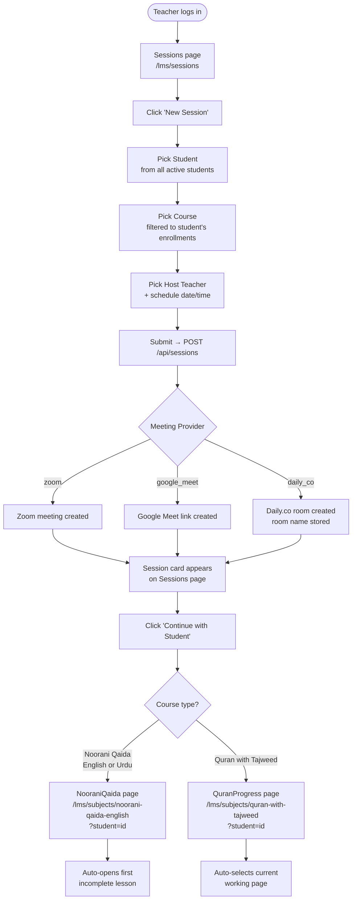
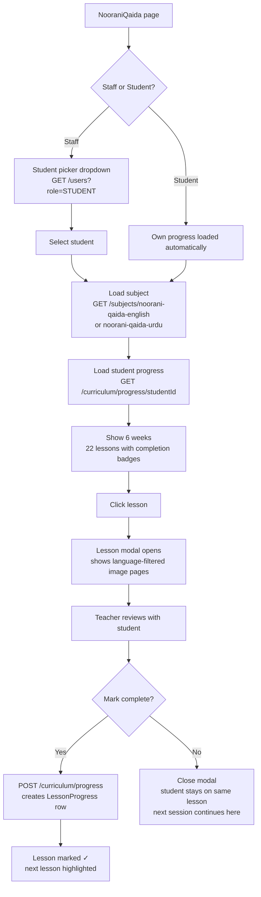
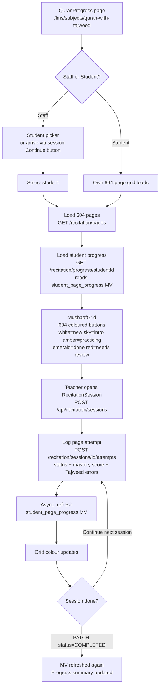
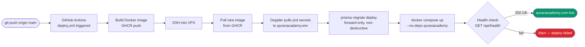
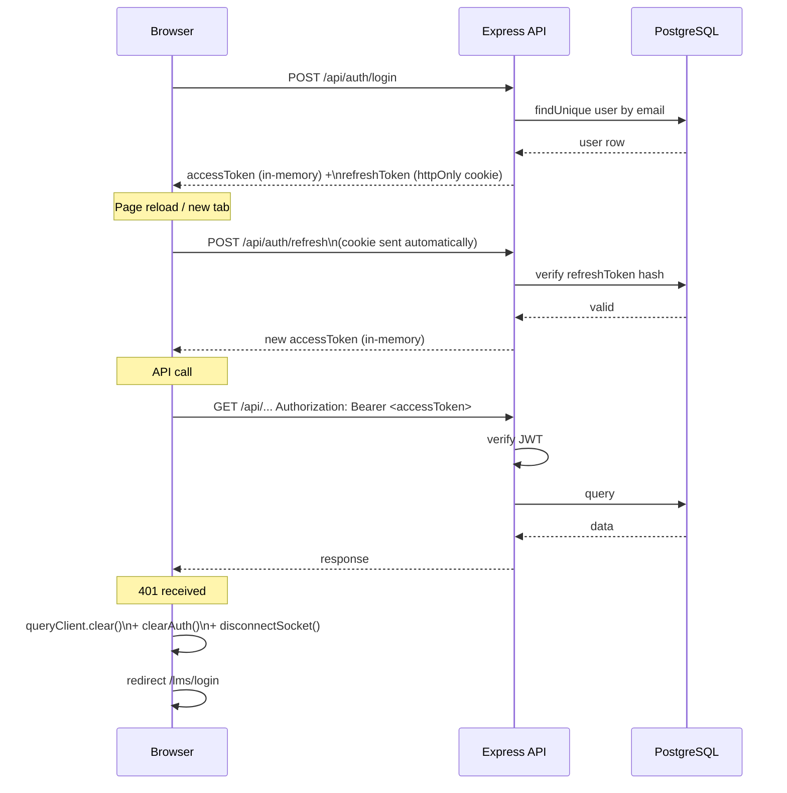
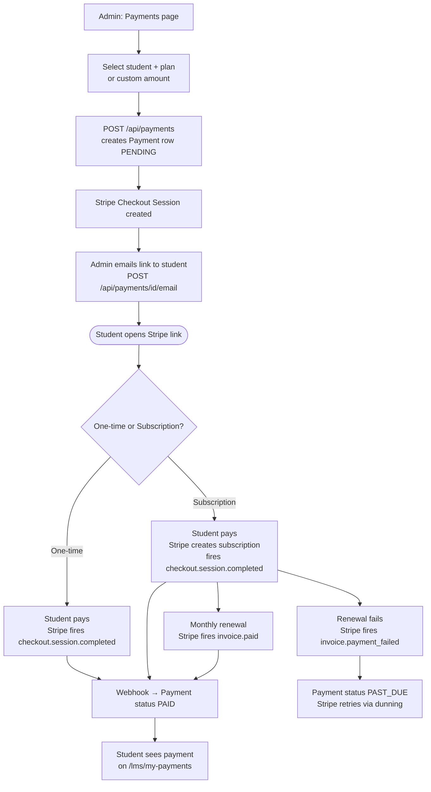

# Quran Academy — System Flow Diagrams

## 1. Teacher Session Workflow

---

## 2. Noorani Qaida — Lesson Progress Flow

---

## 3. Quran with Tajweed — Page Attempt Flow

---

## 4. Deployment Flow

---

## 5. Auth & Token Flow

---

## 6. Stripe Payment Flow

